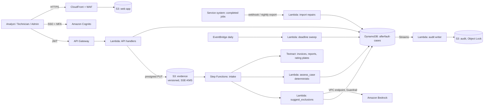

# Afterfault: proposed AWS architecture

Status: this is a design, not a running system. The website and the prototype at `/app` are static front ends. The code in `backend/` has been tested locally only (unit tests, plus fixtures shared with the prototype engine), and nothing has been deployed. The services named here match the website's architecture section: S3, Textract, Lambda, Bedrock, Step Functions and DynamoDB.

## 1. Overview

| Concern | Decision |
|---|---|
| Identity | Cognito, optionally federated to the customer's IdP. Groups map to roles: `analyst`, `technician`, `admin`. |
| Authorisation | Every handler re-checks the role and the tenant from the token, mirroring `src/app/actions.js`. Technicians can read only cases with an open request addressed to them, and only the request fields; amounts are never returned to them. |
| Repairs | Imported from the customer's service or field-service system. The prototype's “New case” form stands in for this. |
| Evidence | Versioned S3 with presigned uploads (5 min, size and type limits) and a malware scan before Textract. Records are never overwritten. |
| Extraction | Textract reads invoice totals, rating-plate serials and report fields. Extracted values are shown to the analyst with the source page. |
| Rules | `backend/lambdas/assess_case`: coverage period (calendar months, inclusive end date), filing deadline, excluded components, required evidence, serial match, invoice-vs-report total, labour share and cap. It shares its fixtures with the prototype. |
| AI | `backend/lambdas/suggest_exclusions`: Bedrock Converse with a Guardrail. Only the notes and the clause text are sent. Output must quote both or it is discarded. |
| Deadlines | A daily EventBridge sweep re-assesses open cases and notifies the assignee 14 and 7 days before a filing deadline. |
| Audit | DynamoDB Streams feed an S3 bucket with Object Lock (compliance mode). |

## 2. Data model (DynamoDB single table `afterfault-cases`)

| Item | PK | SK | Attributes |
|---|---|---|---|
| Case | `T#<tenant>#C#<case>` | `META` | site, equipment, component, serial, installed, repaired, partsLines, labour, technicianNotes, supplierId, claimStatus, assignee, assessment snapshot, `GSI1PK=T#<tenant>#STATUS#<claimStatus>`, `GSI1SK=<deadline>` |
| Evidence | same | `EV#<name>#<ts>` | s3Key, sha256, extracted value, uploadedBy |
| Request | same | `REQ#<id>` | item, note, by, done, `GSI2PK=T#<tenant>#U#<technician>` |
| Suggestion | same | `AI#<id>` | quotes, decision, reason, decidedBy, model_id, prompt_version |
| Approval / submission / outcome | same | `APPROVAL`, `SUBMISSION`, `OUTCOME` | names, timestamps, supplier reference, amounts |
| Supplier terms | `T#<tenant>` | `TERMS#<supplier>#v<n>` | the rule parameters plus a link to the source document page. Versioned, so past assessments stay explainable. |
| Policy | `T#<tenant>` | `POLICY` | secondApprovalOver, aiSuggestions |

Approval uses `TransactWriteItems` with a condition that the stored assessment is unchanged and, for a second approval, that the approver differs from the first.

## 3. AI controls

1. AI only suggests possible clause exclusions. Every number and date is checked by rules.
2. No identifiers, sites, serials or amounts are sent to the model (`check_input`).
3. Both quotes must exist verbatim in the inputs (`validate`), and malformed output fails closed.
4. Each suggestion is pending until an analyst confirms it (the case cannot proceed) or dismisses it with a written reason.
5. Per-tenant on/off switch. The confirmation rate is tracked on the admin overview.
6. Use Bedrock under terms that exclude customer content from training, and record this in the data-processing agreement.

## 4. Security and retention

KMS keys on DynamoDB, S3 and logs; TLS 1.2+; VPC endpoints for Bedrock and Textract; least-privilege IAM per function, with `dynamodb:LeadingKeys` tenant conditions; WAF rate limits; and structured logs with IDs only, never document text. Default retention: evidence files 7 years after case close (or the customer's record-keeping requirement), closed cases 7 years, audit log 7 years, exports 30 days. All of these need confirming per customer.

## 5. Prototype vs production

| Area | Prototype | Production |
|---|---|---|
| Storage | Browser `localStorage` | DynamoDB + S3 |
| Repairs | Seed data and the “New case” form | Service-system import |
| Records | Technician types the value | Upload + Textract with confirmation |
| Rules | `src/app/engine.js` | `assess_case` (same fixtures) |
| AI | Keyword rule | Bedrock + Guardrail + quote validation |
| Auth | “Demo as” switch | Cognito + server-side checks |
| Submission | Recorded manually | Recorded manually; supplier portal integrations later, per supplier |

## 6. Not legal advice

Supplier warranty terms differ, and the customer's own contracts govern. Afterfault applies the terms the customer enters; it does not decide eligibility, and potential amounts are not promises of recovery.
